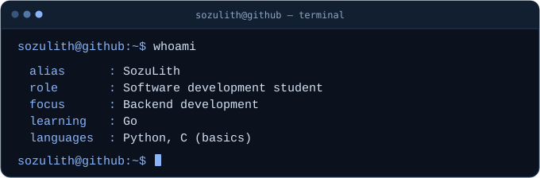

<!-- BANNER -->

  

<h3 align="center">あなたは誰のも</h3>

<!-- ABOUT -->

<h3 align="center">「 自己紹介 — About me 」</h3>

<!-- TECHNOLOGIES -->

  

<h3 align="center">「 技術 — Technologies 」</h3>

  

<!-- ACTIVITY -->

  

<h3 align="center">「 活動 — Activity 」</h3>

  

<!-- FOOTER -->

  

  

<!-- END -->
