<!-- BANNER -->

  

<!-- JAPANESE TITLE -->

  <strong>あなたは誰のもの</strong>

<!-- ANIMATED TITLE -->

  

<!-- PROFILE PANEL -->

  

<!-- ACTIVITY -->

<h3 align="center">「 活動 — Activity 」</h3>

  

